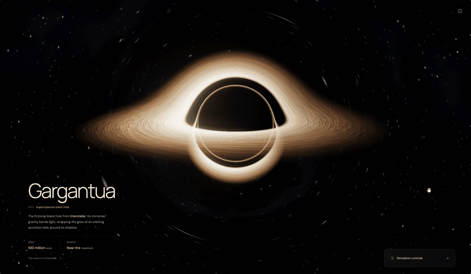

# Gargantua

<p align="center">A black hole in the browser, inspired by Gargantua from <em>Interstellar</em>.</p>

<p align="center">
  
  
  
</p>

<p align="center">
  
</p>

## About

This was built with OpenAI Codex using `gpt-6-astra` as a personal experiment with Three.js and shaders. The idea was to recreate the look of Gargantua: a dark center, a glowing disk, and light bending around it. You can move the camera and explore it from different angles.

From the first prompt to the finished repository, the whole experiment took about 20 minutes.

It uses approximate light bending and a few visual effects to get that look. It is not a scientifically accurate black hole simulation.

## Features

- Animated accretion disk with a warm glow.
- Gravitational lensing and a background star field.
- Mouse, touch, and keyboard camera controls.
- Cinematic, edge-on, and overhead camera presets.
- Adjustable disk brightness, optional stars, and automatic orbit.
- A collapsible control panel and a layout that works on smaller screens.
- Reduced-motion support.

## Requirements

- Node.js 22.12 or newer on a supported LTS release.
- npm.
- A browser with WebGL 2 support. Hardware acceleration is recommended.

No API keys, database, or backend are needed.

## Run locally

From the project folder:

```bash
npm ci
npm run dev -- --port 5173 --strictPort
```

Open [localhost:5173](http://localhost:5173).

## Controls

| Action | Control |
| --- | --- |
| Orbit | Drag or use the arrow keys |
| Zoom | Scroll, pinch, or press + / − |
| Minimize or expand settings | Click the panel heading or press H |

The settings panel contains the brightness slider, star and auto-orbit switches, and camera presets. The information button opens a short controls guide.

## Build

```bash
npm run build
npm run preview -- --port 4173 --strictPort
```

Open [localhost:4173](http://localhost:4173) to preview the build. The generated files are in `dist/`.

## Project notes

- [AGENTS.md](AGENTS.md): short notes for working on the project.
- [Project guide](docs/index.md): rendering details, limitations, and browser checks.

Inspired by *Interstellar*. The facts shown in the app reference an excerpt from Kip Thorne's [The Science of Interstellar](https://www.space.com/28077-science-of-interstellar-book-excerpt.html).
